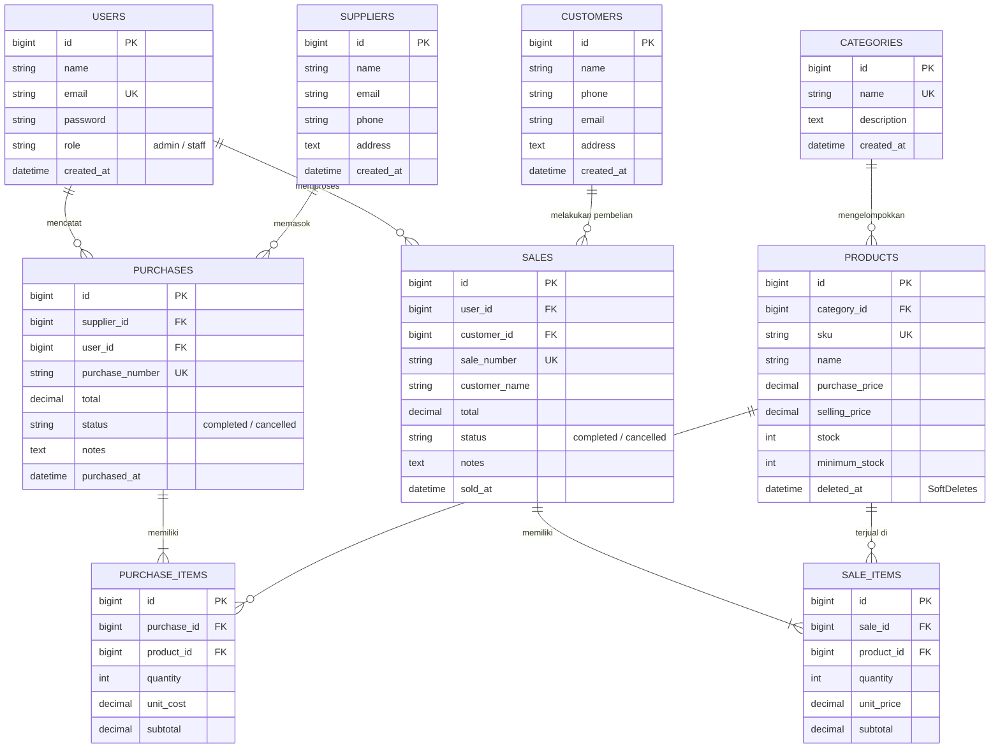

# Integrated Laravel Project: Inventory & Sales Management System
> **Web Programming 2 | Ujian Tengah Semester (UTS)**  
> Membangun aplikasi bisnis terintegrasi menggunakan **Laravel 13**, **MySQL / MariaDB**, **Eloquent ORM**, autentikasi berbasis sesi, otorisasi role di server-side, validasi ketat, serta konsistensi logika transaksi dan stok.

---

## Daftar Isi
1. [Project Overview](#1-project-overview)
2. [Spesifikasi & Kebutuhan Sistem](#2-spesifikasi--kebutuhan-sistem)
3. [Panduan Instalasi & Menjalankan Aplikasi](#3-panduan-instalasi--menjalankan-aplikasi)
4. [Akun Demo Pengujian](#4-akun-demo-pengujian)
5. [Skema Database & ERD](#5-skema-database--erd)
6. [Penjelasan Relasi Eloquent & Pencegahan N+1](#6-penjelasan-relasi-eloquent--pencegahan-n1)
7. [Aturan Bisnis & Integritas Transaksi](#7-aturan-bisnis--integritas-transaksi)
8. [Pengujian Otomatis (Test Scenarios)](#8-pengujian-otomatis-test-scenarios)
9. [Persiapan Pertanyaan Code Interview](#9-persiapan-pertanyaan-code-interview)
10. [Known Limitations (Batasan Sistem)](#10-known-limitations-batasan-sistem)

---

## 1. Project Overview
Sistem ini dirancang untuk mengatasi permasalahan pencatatan manual pada usaha distribusi kecil:
- **Konsistensi Stok Real-time:** Stok bertambah saat transaksi Pembelian (PO) sukses dan berkurang saat transaksi Penjualan (Invoice) sukses.
- **Pencegahan Overselling:** Penjualan divalidasi langsung terhadap stok riil menggunakan `lockForUpdate()` agar tidak dapat menjual barang melebihi stok yang tersedia.
- **Integritas Database Atomik:** Header transaksi dan detail item dibungkus dalam `DB::transaction()`. Jika ada satu item gagal, seluruh perubahan di-rollback secara otomatis.
- **Role-based Access Control (RBAC):** Pemisahan hak akses antara **Admin/Owner** dan **Staff** yang dilindungi di level server melalui middleware dan Gates.

---

## 2. Spesifikasi & Kebutuhan Sistem
- **PHP:** >= 8.2 (Teruji pada PHP 8.5 / 8.3)
- **Database:** MySQL / MariaDB (XAMPP Default port 3306)
- **Framework:** Laravel 13.x
- **Dependency Manager:** Composer 2.x
- **Styling:** Custom Modern Vanilla CSS (Plus Jakarta Sans, responsive grid, glassmorphic cards, receipt print styles).

---

## 3. Panduan Instalasi & Menjalankan Aplikasi

Ikuti langkah-langkah berikut untuk menjalankan project di environment baru:

### Langkah 1: Clone Repository & Masuk Direktori
```bash
git clone <repository-url>
cd "uts web"
```

### Langkah 2: Install Dependensi PHP
```bash
composer install
```

### Langkah 3: Konfigurasi Environment (`.env`)
Salin file konfigurasi contoh:
```bash
cp .env.example .env
```
Pastikan pengaturan database di file `.env` sudah sesuai dengan MySQL Anda:
```env
DB_CONNECTION=mysql
DB_HOST=127.0.0.1
DB_PORT=3306
DB_DATABASE=inventory_sales
DB_USERNAME=root
DB_PASSWORD=
```

### Langkah 4: Generate Application Key
```bash
php artisan key:generate
```

### Langkah 5: Jalankan Migration & Seeding
Pastikan MariaDB/MySQL telah aktif, lalu jalankan:
```bash
php artisan migrate:fresh --seed
```
*Perintah ini akan membuat seluruh tabel dari skema migration dan mengisi data awal (kategori, supplier, produk demo, dan akun).*

### Langkah 6: Jalankan Server Lokal
```bash
php artisan serve
```
Aplikasi dapat diakses melalui browser di: `http://localhost:8000`

---

## 4. Akun Demo Pengujian & Portal Pengguna

Aplikasi dilengkapi dengan tombol auto-fill kredensial pada halaman login untuk memudahkan pengujian dosen/evaluator:

| Role | Email | Password | Wewenang & Halaman Utama |
|---|---|---|---|
| **Admin / Owner** | `admin@example.com` | `password` | Akses penuh: Kelola Pengguna, CRUD Kategori, Produk, Pemasok, Pelanggan, Melihat seluruh transaksi, Dashboard analitik, Membatalkan transaksi (Rollback stok). |
| **Staff Operasional** | `staff@example.com` | `password` | Melihat katalog produk, Membuat transaksi pembelian (Stock-In), Membuat transaksi penjualan (Stock-Out), Melihat detail invoice. |
| **Pembeli (Customer)** | `pembeli@example.com` | `password` | **Portal Pelanggan:** Dashboard Pembeli (`/customer/dashboard`), Katalog Belanja (`/customer/catalog`), Checkout Mandiri (`/customer/order`), Riwayat & Cetak Faktur Pesanan (`/customer/orders`). |

> **Fitur Registrasi Mandiri:** Calon pembeli baru dapat langsung mendaftar secara mandiri melalui halaman [Pendaftaran Akun Pembeli](http://localhost:8000/register). Sistem akan otomatis membuat akun user dengan role `customer`, menyimpan profil pelanggan, dan mengarahkan langsung ke portal belanja.

## 5. Skema Database & ERD

### Diagram ERD (Entity Relationship Diagram)


---

## 6. Penjelasan Relasi Eloquent & Pencegahan N+1

1. **`Category hasMany Products`** & **`Product belongsTo Category`**:
   - Satu kategori dapat memiliki banyak varian produk.
   - Foreign key `category_id` terletak pada tabel `products` karena satu baris produk merujuk ke induk kategorinya.
2. **`Purchase hasMany PurchaseItems`** & **`PurchaseItem belongsTo Purchase`**:
   - Satu header pembelian dapat memuat banyak item barang berbeda.
   - Foreign key `purchase_id` dan `product_id` berada pada tabel perincian (`purchase_items`).
3. **`Sale hasMany SaleItems`** & **`SaleItem belongsTo Sale`**:
   - Satu invoice kasir dapat menjual banyak barang secara bersamaan.
4. **Pencegahan Masalah N+1 Query:**
   Semua controller menggunakan *Eager Loading* (`with(...)`):
   ```php
   // Contoh pada ProductController:
   $products = Product::with('category')->paginate(10);
   
   // Contoh pada SaleController:
   $sales = Sale::with(['user', 'items.product'])->paginate(10);
   ```
   Hal ini memastikan pengambilan data dilakukan dalam **2 query teroptimasi**, bukan mengeksekusi 1 query tambahan untuk setiap baris data (menghindari ratusan query redundant ke MySQL).

---

## 7. Aturan Bisnis & Integritas Transaksi

- **SKU Produk Unik:** Dilindungi oleh validasi form request dan `UNIQUE` constraint pada MySQL database.
- **Kalkulasi Harga di Server-Side:** Total invoice dan subtotal dihitung langsung oleh server dengan mengambil `selling_price` resmi dari database untuk mencegah manipulasi harga dari browser inspect element.
- **Concurrency & Pencegahan Overselling:** Menggunakan `Product::lockForUpdate()` di dalam `DB::transaction()`:
  ```php
  DB::transaction(function () use ($request) {
      // Baris produk dikunci sementara hingga transaksi selesai
      $product = Product::lockForUpdate()->findOrFail($productId);
      if ($qty < 1 || $product->stock < $qty) {
          throw ValidationException::withMessages([
              'items' => "Stok produk '{$product->name}' tidak mencukupi."
          ]);
      }
      $product->decrement('stock', $qty);
  });
  ```
- **Atomisitas:** Jika salah satu item gagal (misal salah satu produk kehabisan stok), seluruh database transaction otomatis di-rollback tanpa menyisakan data setengah jadi.
- **Rollback Stok pada Pembatalan Transaksi:** 
  - Pembatalan transaksi penjualan akan mengembalikan kuantitas barang ke stok gudang.
  - Pembatalan transaksi pembelian akan mengurangi stok gudang kembali setelah memastikan stok tidak menjadi negatif.
- **Perlindungan Riwayat Transaksi (Soft Delete):** Produk menggunakan `SoftDeletes` dan foreign key constraint `restrictOnDelete` agar produk yang memiliki riwayat penjualan/pembelian tidak hilang dari laporan audit keuangan.

---

## 8. Pengujian Otomatis (Test Scenarios)

Aplikasi telah dilengkapi unit & feature test suite lengkap mencakup seluruh skenario wajib pada rubrik UTS:

Jalankan test suite menggunakan perintah:
```bash
php vendor/bin/phpunit
```
Hasil pengujian:
```
OK (10 tests, 35 assertions)
```

### Rincian Skenario yang Teruji:
1. **Auth:** Guest tidak dapat mengakses dashboard (dialihkan ke `/login`); Percobaan login dengan password salah ditolak dengan pesan error yang jelas.
2. **Product:** Input SKU duplikat ditolak; Harga negatif (`< 0`) ditolak oleh validasi server.
3. **Purchase:** Transaksi pembelian berhasil menambah jumlah stok fisik secara konsisten.
4. **Sale:** Transaksi penjualan berhasil mengurangi stok secara akurat.
5. **Insufficient Stock:** Penjualan yang melebihi batas stok langsung ditolak tanpa mengubah data stok database.
6. **Atomicity:** Pada transaksi multi-item, jika item kedua gagal, perubahan pada item pertama di-rollback secara utuh.
7. **Authorization:** Akun Staff ditolak (HTTP 403) saat mencoba mengakses fitur khusus Admin (kelola user, edit/hapus master data).
8. **Search & Filter:** Pencarian SKU, filter kategori, dan filter stok rendah (`low_stock`) menghasilkan data yang akurat.

---

## 9. Persiapan Pertanyaan Code Interview

Berikut adalah panduan jawaban resmi untuk sesi wawancara kepemilikan kode (Code Ownership Interview):

1. **Mengapa Sale memiliki relasi `hasMany` ke SaleItem?**  
   *Jawaban:* Karena satu transaksi penjualan (header faktur) dapat terdiri dari satu atau lebih item produk yang berbeda. Relasi 1-to-many memisahkan metadata transaksi (faktur, kasir, waktu, total) dengan rincian kuantitas serta harga masing-masing produk.

2. **Di mana sistem memastikan stok tidak menjadi negatif?**  
   *Jawaban:* Pada `SaleController::store()` di dalam blok `DB::transaction()`. Sebelum memotong stok dengan `$product->decrement()`, sistem memeriksa `$product->stock < $qty`. Jika tidak mencukupi, sistem langsung melempar `ValidationException` sehingga proses dibatalkan.

3. **Mengapa total penjualan dihitung di server?**  
   *Jawaban:* Menghitung total di server adalah prinsip keamanan dasar (*Zero Trust Client*). Input atau data di browser dapat dimodifikasi oleh user melalui Developer Tools. Server mengambil harga jual resmi dari database produk dan menghitung subtotal secara independen.

4. **Apa risiko jika pengurangan stok dilakukan di luar `DB::transaction`?**  
   *Jawaban:* Data dapat menjadi korup atau tidak sinkron (*partial write*). Misalnya, record transaksi penjualan berhasil tersimpan namun server mengalami error saat menyimpan detail item kedua, atau sebaliknya stok terlanjur terpotong padahal pembuatan faktur gagal. `DB::transaction` menjamin seluruh aksi berhasil secara penuh (*commit*) atau dibatalkan seutuhnya (*rollback*).

5. **Bagaimana mencegah Staff mengakses fungsi Admin melalui URL langsung?**  
   *Jawaban:* Menggunakan middleware proteksi di server (`EnsureUserRole` alias `role:admin`) dan Laravel Gates (`Gate::define('admin', ...)`). Jika staff mengakses URL `GET /users` atau mengirim request `DELETE /categories/1`, server merespons dengan `HTTP 403 Forbidden`, bukan sekadar menyembunyikan tombol di antarmuka Blade.

6. **Apa yang terjadi jika dua penjualan memproses stok produk yang sama hampir bersamaan?**  
   *Jawaban:* Terjadi potensi *Race Condition* / *Overselling*. Sistem mencegah hal ini dengan memanggil method `Product::lockForUpdate()`. Baris data produk pada MySQL akan di-*lock* (pessimistic locking) oleh transaksi pertama hingga selesai, sehingga transaksi kedua harus menunggu dan membaca saldo stok terbaru yang telah terpotong.

7. **Tunjukkan validasi SKU unik dan jelaskan peran constraint database.**  
   *Jawaban:* Validasi ada di `ProductController` dengan aturan `'sku' => ['required', 'unique:products,sku']`. Constraint level database (`$table->string('sku')->unique()`) berfungsi sebagai pertahanan lapisan akhir (*last line of defense*) untuk menjamin tidak ada duplikasi data meskipun terjadi request konkuren.

8. **Ubah aturan minimum stock dan tunjukkan dampaknya.**  
   *Jawaban:* Batas minimum stok disimpan pada kolom `minimum_stock` di tabel `products`. Jika nilai ini diubah (misalnya dari 5 menjadi 10), method `isLowStock()` pada Model Product (`$this->stock <= $this->minimum_stock`) dan query dashboard akan langsung mendeteksi produk tersebut masuk ke dalam daftar peringatan "Stok Rendah" secara dinamis.

---

## 10. Known Limitations (Batasan Sistem)
- Aplikasi fokus pada single-location inventory (belum mendukung multi-cabang/warehouse terpisah).
- Metode pembayaran pada transaksi kasir menggunakan pencatatan kas internal (tidak terintegrasi ke payment gateway perbankan nyata sesuai batasan soal).
- Pembatalan transaksi pembelian dibatasi jika sisa stok gudang sudah lebih kecil dari kuantitas yang dibatalkan (mencegah stok menjadi minus).
